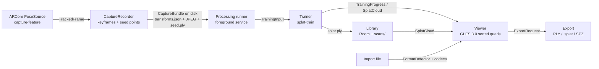
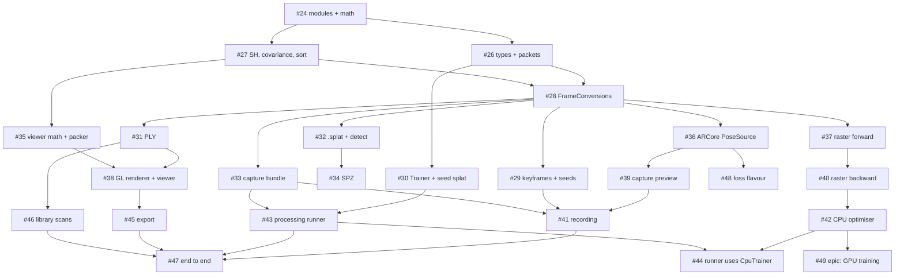

# Splatman architecture

Decided by the architecture council of ticket #2 (2026-11-01); the debate, consensus and dissents are in
[council.md](council.md). Each decision is an ADR in [adr/](adr/). Change a decision with a new ADR that supersedes
the old one, not by editing it.

## The pipeline

All in-app geometry is in **one frame, W** (ARCore world: right-handed, +Y up, metres). Quaternions are Hamilton,
stored **w, x, y, z**. Files are converted at their boundary, in one file (`FrameConversions.kt`).

## Modules

| Module | Kind | Holds |
|---|---|---|
| `splat-core` | pure Kotlin/JVM | math, frames, model types, packets, SH, covariance, sort, keyframe policy |
| `splat-io` | pure Kotlin/JVM | PLY, `.splat`, SPZ codecs; format detection; capture bundle |
| `splat-train` | pure Kotlin/JVM | `Trainer`, seed initialisation, CPU rasteriser forward/backward, optimiser |
| `splat-gpu` | Android library | GLES 3.1 compute training on an offscreen EGL context; CPU fallback ([ADR 0010](adr/0010-gpu-training.md)) |
| `capture-feature` | Android | ARCore `PoseSource`, capture screen, recorder, processing runner |
| `viewer-feature` | Android | GL renderer, packer, viewer screen, export |
| `library-feature` | Android | scan records and files, library screen |
| `core`, `app` | Android | design system, navigation, wiring |

## Decisions

| ADR | Decision |
|---|---|
| [0001](adr/0001-module-layout.md) | Three pure-JVM modules for maths and bytes; Android modules wrap them; a `testDebugUnitTest` alias keeps their tests in the gate |
| [0002](adr/0002-core-types.md) | `SplatCloud` struct-of-arrays of raw parameters (log-scale, logit opacity, wxyz, SH channel-major); immutable intrinsics, pose, keyframe; versioned packets |
| [0003](adr/0003-coordinate-frames.md) | Frames W, Cgl, Ccv, I, NDC, F (RDF files), SPZ/glTF, Nerfstudio; the exact conversions incl. SH sign flips; one owner file |
| [0004](adr/0004-tracking.md) | ARCore (`getPose` + `getImageIntrinsics` + CPU image) behind `PoseSource`; optional at install; no ARCore in a future `foss` flavour |
| [0005](adr/0005-training.md) | On-device only, no network; seed splat first, then a CPU optimiser; GPU compute later; desktop training via the exported bundle |
| [0006](adr/0006-rendering.md) | GLES 3.0 sorted instanced quads, data in textures, CPU 16-bit sort off the GL thread; 60 fps at 300k splats |
| [0007](adr/0007-formats.md) | 3DGS PLY (default), `.splat`, SPZ; glTF later; capture bundle = Nerfstudio `transforms.json`; pose-free capture (`capture.json`, `imu.csv`, `calibration.json`) |
| [0008](adr/0008-libraries.md) | Write the maths and codecs; adopt ARCore (optional), kotlinx.serialization, java.util.zip; no INRIA code |
| [0009](adr/0009-testing.md) | JVM unit tests with fixed fixtures and stated tolerances for every conversion, codec, packet and kernel; CPU rasteriser as golden renderer |
| [0010](adr/0010-gpu-training.md) | GPU training in a new `splat-gpu` module: GLES 3.1 compute, same sort order as the CPU, no gradient atomics, on-device parity tests with fixed tolerances; fills in point 5 of 0005 |
| [0011](adr/0011-crop.md) | Crop: one `CropBox` in W (centre-inclusive rule, UI W-aligned only), 5..95th percentile start box, `splat.uncropped.ply` kept on first Apply with a crash-safe rename order, samples cropped to `filesDir/sample-crops/` |
| [0013](adr/0013-library-folders.md) | Library folders as Room rows only (DB v4, `MIGRATION_3_4`, `scans.folderId`, no FK), files stay flat; `LibraryText.key` for names and search; NEWEST/OLDEST/NAME/SIZE sort in `library_prefs`; in-memory search; `library/folder/{folderId}` route |
| [0012](adr/0012-foss-pose-source.md) | foss pose source (proposed): post-capture SfM, OpenCV in native `splat-sfm`, the rest in `splat-core` `sfm`; fallback #201 OpenVINS |
| [0015](adr/0015-retire-arcore.md) | Retire ARCore and the `full` flavour: foss is the one build (no flavours, dependency guard on every variant); `PoseSource`/`TrackedFrame` stay as the seam for #336; removal cards #343 to #349 after #230 |
| [0016](adr/0016-own-vio.md) | Our own VIO, staged: stage 1 visual-inertial BA after capture in Kotlin (splat-core sfm/vi) plus gyro/autofocus guidance; stage 2 live MSCKF in NDK C++ behind a start gate and an 8-week kill gate; tracking stream in the pose-free capture; clean-room rule |

## Build order (child tickets of #2)

The first phone build that captures, shows and exports a real 3DGS file is #47 with the seed splat (#30); #44 then
switches it to the trained splat. The design cards from #4 (#14-#21) restyle the screens these cards build and are
ordered after them. The poker cleanup is #6.

The children of #49 (GPU training) share [ADR 0010](adr/0010-gpu-training.md) and are built after #42; each keeps the CPU
path bit-identical and checks its stage against it with the ADR's tolerances.
