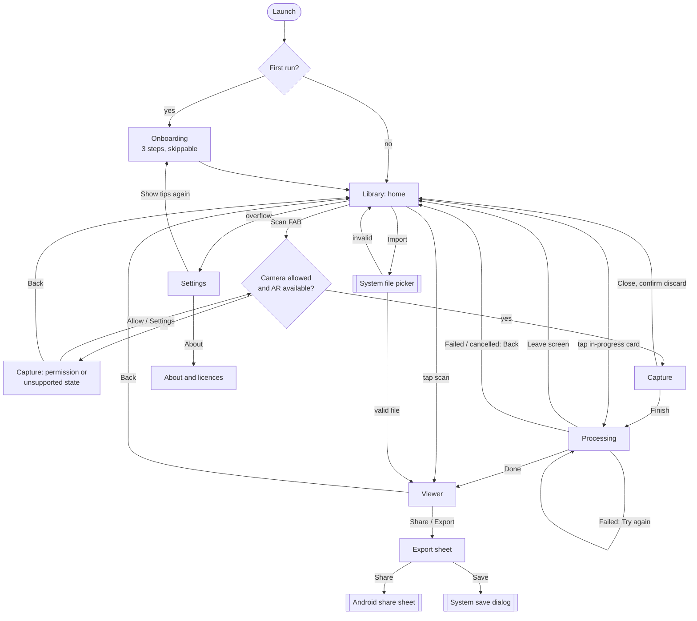

# Splatman design: v1 features, flows and screens

The product and UI spec for the rebuild (ticket #4). The data model and pipeline are in `docs/architecture/` (#2);
this folder covers only what the user sees. Build tickets per screen point back here.

| File | What it holds |
|---|---|
| [tokens.md](tokens.md) | Colour, type, spacing, shape, elevation, motion, icons, haptics: the `core/design` table |
| [copy.md](copy.md) | Voice and the exact strings for key moments |
| [screens/](screens/) | One short spec per screen: layout, states, copy keys, accessibility |

## What Splatman is for

Point the phone at something, walk around it, get a 3D Gaussian splat you can orbit and export as a standard file.
Free, offline, no account, nothing leaves the phone. That promise is the product: every app below fails at least one
part of it.

## The council

One designer session voiced four roles who argued from different starting points. Their positions, where they landed,
and what is still disputed:

**Product manager** (studied Scaniverse, Polycam, Luma, KIRI Engine, Teleport). What these apps do well: Scaniverse
processes on the device and is quick to a first result; Luma and Teleport get the best quality from a slow, guided
walk; Polycam's library and share flow is the most polished. What users complain about most, in roughly this order:
exports locked behind a paywall or an account; uploading and waiting in a cloud queue; a scan that fails after
minutes of processing with no reason given; floaters and blur they could not see coming while they were capturing;
files that no other tool opens. Position: v1 must win on *private, free, standard files*, plus a capture that tells
you in time when it is going badly. Wanted a Room mode in v1.

**Senior mobile UI designer** (Material 3, Compose, dark-first camera UI). Position: drop the three-tab bottom bar.
The app has one job, so the library is home and "Scan" is the one big button. Camera and viewer are full-bleed and
always dark, with chrome that floats on scrims and gets out of the way. Wanted dark-only throughout.

**UX researcher** (first-run capture success). Position: most failed scans are decided in the first 20 seconds:
moving too fast, low light, a shiny or plain subject, or losing tracking. So guidance has to be live and specific,
not a tips page: one instruction at a time, a coverage gauge that fills as you walk, and "Finish" held back until the
coverage is enough. Failure must keep the frames, so the user can retry processing without capturing again.

**Accessibility reviewer**. Position: coverage cannot be colour-only; every warning needs text plus a haptic, not
just a tint; the camera overlay needs a scrim so text meets AA on any background; 48 dp targets (above the 44 px
floor); gestures in the viewer need button alternatives; respect system font scale and "remove animations". Insisted
the library and settings follow the system light/dark setting.

**Converged on**
- Library is home; no bottom navigation. Capture, Processing and Viewer are full-screen destinations.
- One capture mode in v1: orbit a subject. The coverage ring, live warnings and gated Finish are the core of v1.
- Processing runs in a foreground service with a notification, so the user can leave the screen.
- A failed or cancelled build keeps its frames; "Try again" never needs a new capture.
- Export is free, one sheet, two standard formats (PLY and .splat); share and save both work offline.
- Camera, processing and viewer are always dark. Library, onboarding and settings follow the system theme
  (accessibility won this one over the designer).
- No dynamic colour (Material You) in v1: the brand violet stays fixed.

**Dissents recorded**
- PM: Room mode should be v1, because people scan rooms. Lost on scope: the ring only makes sense for an orbit, and a
  room needs a different gauge. First on the later list after cleaning.
- Designer: wanted the viewer to support a light background. Lost: splats with dark edges read best on dark.
- Researcher: wanted an in-world AR overlay (dots on the floor around the subject) instead of a 2D ring. Lost on
  cost tonight: a 2D ring needs no AR renderer. Kept on the later list.
- Accessibility: wanted a "Describe this scan" text alternative in the viewer. Deferred; the info sheet gives
  counts and size in text for now.

## v1 features

1. **Capture with live guidance**: full-screen camera with ARCore tracking; pick a subject; a coverage ring fills as
   you walk around it at three heights; one live instruction at a time (move slower, too dark, tracking lost, too
   close, too far); Finish unlocks at enough coverage.
2. **Processing with honest progress**: named stages, percent, a time estimate once it is reliable, a live preview of
   the splat forming, runs in the background with a notification, cancel, a hot-phone state, and a failure that says
   why and keeps the frames.
3. **Viewer**: orbit (one finger), pan (two fingers), zoom (pinch), double-tap to reset; buttons for the same; tap to
   hide the chrome; an info sheet (splats, size, frames, date).
4. **Library**: a grid of scans with thumbnails, names, dates and sizes; in-progress and failed scans shown in place;
   rename and delete; multi-select delete; samples to try when empty.
5. **Export and share**: standard 3DGS PLY and `.splat`; share through the Android share sheet or save to a folder
   the user picks; no limits, no account.
6. **Import**: open a `.ply` or `.splat` from the system file picker; clear errors, including "this PLY is a point
   cloud, not a splat".
7. **Onboarding**: three short screens on first run (what it is, how to scan well, camera permission), all skippable;
   handles "phone cannot track motion" without dead-ending (the app still views and imports).
8. **Settings**: theme, default export format, keep capture frames, storage used and clear, haptics, show the
   tips again, about (version, licences, sample attributions, source).

## Later, ranked

1. Crop and clean: a box crop ([screens/crop.md](screens/crop.md)) and a floater brush
   ([screens/erase.md](screens/erase.md)) (floaters are the top quality complaint everywhere).
2. Room mode: capture a space, with a gauge suited to walking through rather than around. Shipped (pose-free, gyro
   Seen gauge): [screens/capture.md](screens/capture.md#room-mode).
3. Quality presets (Fast, Balanced, Best) once training time is known on real phones.
4. In-world coverage overlay (AR dots around the subject) replacing or beside the ring.
5. AR placement: put a finished splat back into the room through the camera.
6. Measurement: tap two points for a distance (needs the scale question of #3 settled).
7. More export formats: SPZ, glTF `KHR_gaussian_splatting`, and a mesh (GLB or OBJ) for tools that cannot read splats.
8. Turntable video export for sharing to people without a splat viewer.
9. Library search, sort and folders.
10. Import from a video file instead of a live capture.
11. Optional self-hosted training server (only if #2 decides it is worth having).

## Information architecture

Navigation routes (for the shell ticket): `onboarding`, `library`, `capture`, `processing/{scanId}`,
`viewer/{scanId}`, `settings`, `about`. The export sheet is a modal on the viewer, not a route. System back always
goes one level up; from Capture it asks before discarding.

## Screens

| Screen | Spec | States |
|---|---|---|
| Onboarding | [screens/onboarding.md](screens/onboarding.md) | welcome, tips, camera priming, AR unsupported, AR needs install |
| Library (home) | [screens/library.md](screens/library.md) | empty, loading, list, processing card, failed card, selection, long names, wide |
| Capture | [screens/capture.md](screens/capture.md) | permission, unsupported, starting, aim, capturing, warning, paused, ready to finish, discard confirm |
| Processing | [screens/processing.md](screens/processing.md) | queued, running, hot phone, done, failed, cancelled |
| Viewer | [screens/viewer.md](screens/viewer.md) | loading, ready, chrome hidden, gesture hint, info sheet, rename, delete confirm, open error |
| Export sheet | [screens/export.md](screens/export.md) | choose, writing, shared or saved, error, low storage |
| Import | [screens/import.md](screens/import.md) | picking, validating, opened, point-cloud error, unsupported, corrupt, too large |
| Settings and About | [screens/settings.md](screens/settings.md) | default, clear-storage confirm, about, licences |

## Rules every screen keeps

- Tokens only: no literal colour, size or duration in a screen; if one is missing, add it to `core/design` first
  ([tokens.md](tokens.md)).
- Phone width first (360 dp), then wide (600 dp and up: max content width 840 dp, library goes to more columns,
  sheets become dialogs).
- Touch targets 48 dp; visible focus ring on every interactive element for keyboard and switch access.
- Every icon-only button has a content description; every live warning is announced (polite live region) and buzzes.
- Font scale up to 200% must not clip: text wraps, rows grow; the capture overlay drops secondary text first.
- With "remove animations" on, every motion becomes an instant change or a short crossfade.
- No screen shows a spinner without words saying what is happening.

## Build tickets

Filed under #4 (each lands ready when #4 is approved). Screens that read pipeline types also wait on #2's child
tickets.

| Ticket | What | After |
|---|---|---|
| #12 | Design tokens and one theme in `core/design` | |
| #13 | App shell: Library home, routes, no bottom nav, launcher icon | #12 |
| #14 | Onboarding: tips, camera permission, AR availability | #13 |
| #15 | Library screen | #13, #2 |
| #16 | Capture screen with live coverage guidance | #13, #2 |
| #17 | Processing screen and notification | #13, #2 |
| #18 | Viewer screen: chrome, gestures, details | #13, #2 |
| #19 | Settings and About | #13 |
| #20 | Export sheet | #18, #2 |
| #21 | Import flow | #15, #18, #2 |
