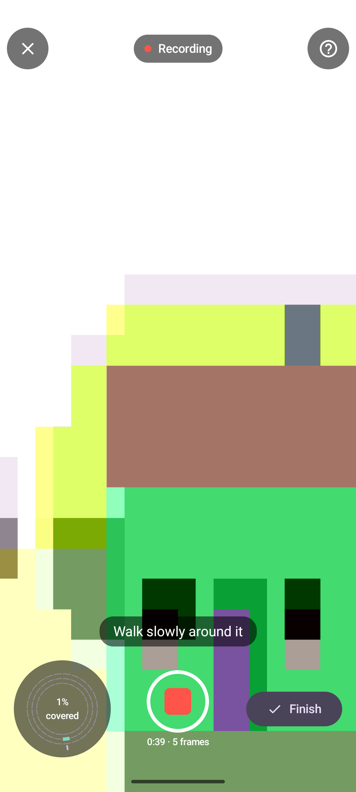
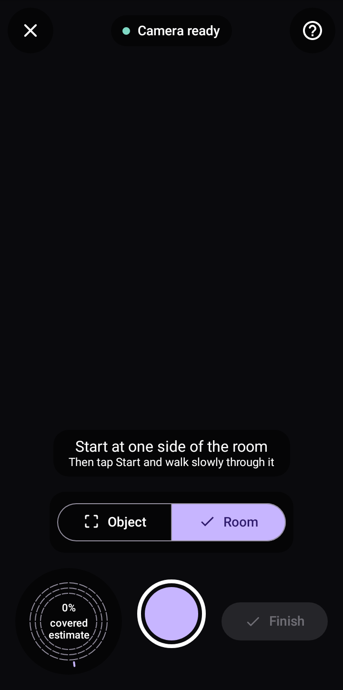
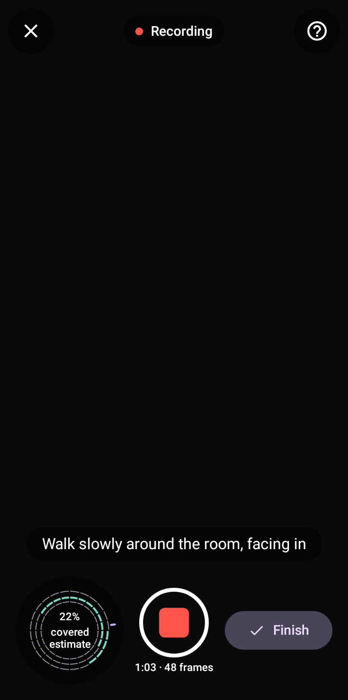
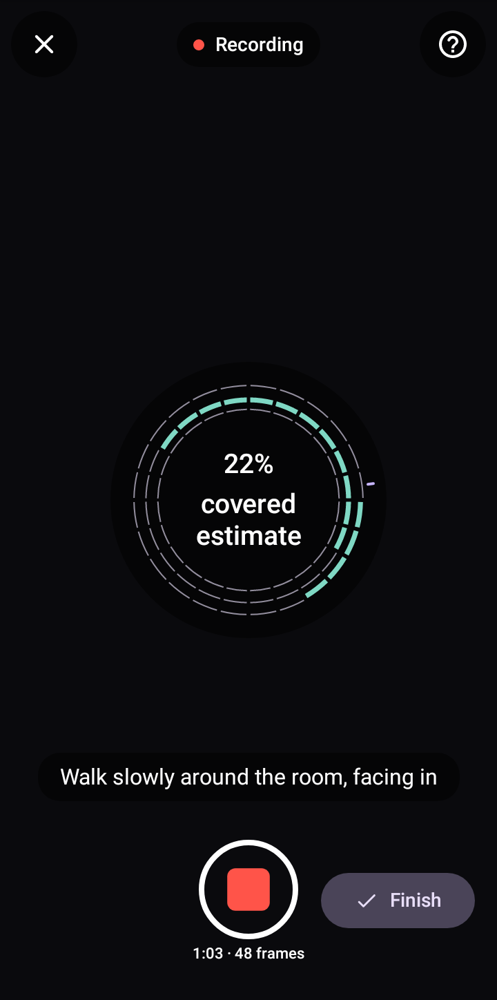

# Capture

Full-bleed camera, always dark, portrait-locked in v1 (rotation would reset the AR session and the user's grip).
Edge-to-edge; the overlay respects system bar and cutout insets. Copy keys: `cap_*`.

## Layout (phone, 360 dp)

```
┌──────────────────────────────┐
│ (✕)   [● Tracking]      (?)  │  icon buttons 48 dp on OverlayScrim circles; status pill
│ ┌──────────────────────────┐ │
│ │ ⚠ Slow down              │ │  warning banner (only when a warning is live)
│ └──────────────────────────┘ │
│                              │
│            ┌ ┐               │  subject reticle (corner brackets), anchored on the
│            └ ┘               │  tapped subject point, projected each frame
│                              │
│   Walk slowly around it      │  instruction, bodyLarge, on OverlayScrim pill
│                              │
│  ╭─ring─╮                    │  coverage ring 112 dp, bottom start
│  │ 46%  │      ( ◉ )   ✓Fin. │  capture button 72 dp centred; Finish bottom end
│  ╰──────╯   1:24 · 38 frames │  labelSmall caption under the button
└──────────────────────────────┘
```

- **Top bar**: Close (`Icons.Rounded.Close`) top start; a status pill centre ("Starting", "Tracking", "Lost
  track") with a 8 dp dot (`secondary` tracking, `tertiary` limited, `error` lost) and the word, always both; Help
  top end opens a sheet with the three `onb_tip_*` rows.
- **Reticle**: four `OverlayOnScrim` corner brackets, 64 dp box, 2 dp stroke, drawn at the subject's screen position.
  Before a subject is set it sits at the screen centre at 50% alpha.
- **Instruction**: one line (wraps to two), centred, on an `OverlayScrim` pill (`CornerDefault`, 16/8 dp padding),
  above the bottom controls. Exactly one instruction at a time; warnings replace it (see priority).
- **Coverage ring**: 24 azimuth segments × 3 height bands drawn as three concentric rings (outer = low, middle =
  level, inner = high). Covered segment: filled `secondary`. Uncovered: `outline` 1 dp stroke, no fill. The
  segment facing the phone's current direction gets a `primary` tick outside the ring. The centre shows the total in
  `numeral` (`cap_coverage`). The ring sits on an `OverlayScrim` disc. Tap on it toggles a larger 200 dp version
  centred on screen (for low vision).
- **Capture button** (72 dp, centre): idle = white ring with a `primary` filled disc; recording = `RecordRed` rounded
  square inside the ring (shape changes, not only colour); paused = white ring with a play triangle. Content
  description follows the state: "Start capture", "Pause capture", "Resume capture".
- **Finish** (bottom end): a filled tonal button with a check icon and the word "Finish". Disabled (38%) until
  coverage reaches the threshold set by the trainer ticket (placeholder: 40% with at least 2 bands touched); then
  `primary` filled, one `CONFIRM` haptic and `cap_ready` as the instruction.
- **Caption** under the capture button: elapsed time and frames kept, `labelSmall`, tabular figures.

Wide (600 dp+, tablets): same layout, ring 136 dp, controls in a column along the end edge instead of the bottom.

## States

| State | What shows |
|---|---|
| Permission not granted | dark screen, centred: camera-off icon, `cap_permission_title`, `cap_permission_body`, button `cap_permission_allow` (or `cap_permission_settings` once permanently denied), text button Back |
| AR unsupported / not installed | as onboarding's AR states, inside this screen, with Back |
| Starting | camera preview fading in; pill "Starting"; instruction `cap_starting`; controls hidden |
| Finding surfaces | pill "Tracking: limited"; instruction `cap_find_surface`; capture button disabled |
| Aim | instruction `cap_aim` plus `cap_aim_hint` as a second smaller line; tap on the preview sets the subject (reticle snaps there with a short scale-in); the capture button enabled ("Start" uses the centre hit if no tap) |
| Capturing | instruction from the guidance sequence: `cap_walk` → `cap_go_higher` → `cap_go_lower`; ring fills |
| Warning | banner under the top bar: `OverlayScrimStrong`, `CornerDefault`, Warning icon in `tertiary` (Lost track: ErrorOutline in `error`), text in `OverlayOnScrim`. Slides down (`DurationMedium`, decelerate), stays at least `GuidanceMinShow`, `REJECT` haptic, announced politely. Frames are not kept while a warning is live (the caption stops counting) |
| Paused | preview dims under `OverlayScrim`; pill "Paused"; ring stays visible; Finish still available if threshold met |
| Ready to finish | Finish enabled; instruction `cap_ready` |
| Discard confirm | Close or system Back with frames captured: dialog `cap_discard_title` / `_body`, buttons `cap_keep_scanning` and `cap_discard_confirm` (`error`). With nothing captured, Close leaves at once |
| Finishing | after Finish: controls fade out, the ring shrinks into the centre (`DurationLong`), then navigate to Processing |

**Warning priority** (highest first, one shown): Lost track > Too dark > Slow down > Too close > Too far. A lower
warning never replaces a higher one before `GuidanceMinShow`; the same warning waits `GuidanceCooldown` before it
can show again.

## Pose-free mode (foss build, #219)

The F-Droid build has no ARCore; it records frames, `imu.csv` and `calibration.json` without poses (PoseFreeRecorder,
ADR 0007) and Processing builds camera positions later. Same layout, tokens and controls as above; only these differ:

| Part | Pose-free |
|---|---|
| Phases | Checking while the recorder opens; Permission, Failed (`capture_failed` + Try again) as above. Unsupported only when the phone has no back camera the recorder can open (foss `ar_unsupported_*`: no usable camera). Never Install needed or Couldn't check |
| Stages | Starting → Aim → Capturing ⇄ Paused → Finishing. No Finding surfaces: the camera is ready as soon as frames arrive |
| Status pill | Starting (`tertiary`), Ready `cap_status_ready` (`secondary`) before recording, Recording `cap_status_recording` (`RecordRed` dot) while recording, Paused as above. Never Tracking, Tracking: limited or Lost track |
| Reticle | none, and the preview takes no taps (no subject: the whole frame is the scan) |
| Aim | `cap_pf_aim` with `cap_pf_aim_hint` as the second line (dropped at 200% font like `cap_aim_hint`) |
| Capturing | the same `cap_walk` → `cap_go_higher` → `cap_go_lower` sequence and ring, from gyro coverage (yaw from the first frame, bands from gravity). The `primary` facing tick follows the gyro |
| Warnings | only Too dark (`cap_warn_dark`) and Slow down (`cap_warn_fast`: fast turn or two blurred frames running); Too dark > Slow down. Never Lost track, Too close, Too far. Shown while recording, as above |
| Finish | enabled as soon as a recording runs (Capturing or Paused): tonal until coverage is ready, then `primary` filled with the `CONFIRM` haptic and `cap_ready`. Coverage guides here, it does not gate (a tripod or the emulator never fills the ring) |
| Finish with no frames | back to Aim with `capture_nothing_recorded` as the instruction; nothing saved, no navigation |
| Saved | to Processing, which shows its Needs poses state (`proc_needs_poses_*`) |

Background mid-recording pauses frames and sensors (the recorder's `setForeground`) and keeps the recording; back in
front it carries on with the same pill and counts, and the capture time leaves out the time away. Portrait-locked as
above, so rotating the phone changes nothing on screen.



## Accessibility

All warnings are text plus haptic plus announcement; none rely on colour or sound. The ring has a content
description "46 percent covered. Missing: high, left side" (the builder computes the largest missing arc and band).
Controls are reachable with keyboard and switch access in order: Close, Help, Ring, Capture, Finish. At 200% font,
the caption and aim hint are dropped first; the instruction wraps to two lines, then truncates with the full text in
its description.

## Room mode

A second capture mode for scanning a space by walking through it (#284, design README "Later, ranked" #2; built by
#300, #291, #293). It runs on the one build, the pose-free foss path (ADR
[0015](../../architecture/adr/0015-retire-arcore.md) section 5): no live tracker, so the gauge counts gyro *Seen*
cells only and calls its percent an estimate. Same screen, same route (`capture`), same controls, same warning banner
and Pose-free mode rules; only the differences are listed here. Copy keys: `cap_mode_*`, `cap_room_*`,
`cap_status_recording_only` ([copy.md](../copy.md#capture-room-mode)). This section stands alone: edits to the
sections above do not change it.

| Aim (Room selected) | Capturing (gauge) | Large view |
|---|---|---|
|  |  |  |

Goldens (dark and light, 360 × 780 dp): `CaptureRoomAim`, `CaptureRoomGauge`, `CaptureRoomLarge` and
`CaptureRoomAimFont200` under `capture-feature/src/test/screenshots/`.

### Layout (phone, 360 dp, Aim)

```
┌──────────────────────────────┐
│ (✕)   [● Camera ready]   (?) │  status pill cap_status_recording_only (secondary dot)
│                              │
│                              │  no reticle; taps on the preview do nothing
│                              │
│ Start at one side of the room│  instruction pill (cap_room_aim)
│ Then tap Start and walk…     │  hint, smaller (cap_room_aim_hint)
│ ╭────────────┬─────────────╮ │
│ │ ⌜⌟ Object  │ ✓  Room     │ │  mode switch, 48 dp segments, on an OverlayScrim pill
│ ╰────────────┴─────────────╯ │
│  ╭gauge──╮                   │
│  │  0%   │     ( ◉ )  ✓Fin.  │  Finish tonal and disabled until recording runs
│  │estim. │                   │
│  ╰───────╯                   │
└──────────────────────────────┘
```

### Mode switch

- **Component**: Material 3 `SingleChoiceSegmentedButtonRow` (no new component), two segments: Object
  (`Icons.Rounded.CropFree`, echoing the reticle) and Room (`Icons.Rounded.MeetingRoom`), labels `cap_mode_object`
  and `cap_mode_room`. Group description `cap_mode_label`; TalkBack reads "Room, selected" from the segment's own role
  and state.
- **Size and place**: in the bottom column between the instruction pill and the gauge row, on an `OverlayScrim`
  pill (`CornerDefault`, `SpacingSmall` padding). Row height at least `TouchTarget` (48 dp); each segment at least
  120 dp wide, so the pair fits 360 dp inside the `SpacingDefault` margins.
- **Colours**: selected `primary` fill, `onPrimary` icon and label, and the M3 check in place of the icon (shape as
  well as colour). Unselected: no fill, `OverlayOnScrim` icon and label. Both segments have an `outline` 1 dp border.
- **When it shows**: in Aim, and at 38% (disabled) in Finding surfaces. It fades out (`DurationShort`) as recording
  starts and does not come back for this scan, Paused included. To change mode the user closes (discard confirm) and
  scans again; a bundle holds one mode.
- **Default**: the mode last chosen (a preference, survives restarts); Object on first run. Onboarding is unchanged.
- **Switching**: instruction, hint and gauge change at once; no haptic; the new selection is announced.

### Room gauge

Same place, size and chrome as the coverage ring (`CoverageRing` 112 dp, `CoverageRingWide` 136 dp at 600 dp+,
`CoverageRingStroke`, on an `OverlayScrim` disc).

- **Cells**: 24 heading segments × 3 pitch bands from the gyroscope (yaw from the first frame, bands from gravity),
  looking *outward*: a segment is a direction the camera faced, not a side of a subject. Outer band = tilted down
  (floor), middle = level (walls), inner = tilted up (ceiling). The `primary` tick outside the ring marks the
  phone's current heading.
- **Fill**: one filled state only, *Seen*: frames were kept facing this way, and the segment fills in `secondary`.
  Not seen: `outline` 1 dp stroke, no fill. With no positions there is no Covered state.
- **Centre**: the percent of Seen cells in `numeral` (`cap_coverage`), and `cap_room_estimate` under it in
  `labelSmall`, `OverlayOnScrim`: the number is a guide, not a measure.
- **Description**: `cap_ring_missing` with room words, "22 percent covered. Missing: ceiling, behind you"
  (`cap_room_band_*`, `cap_room_side_*`, the side relative to the phone's heading, the largest missing arc).
  Nothing missing: `cap_ring_complete`.
- **Large view**: tap the gauge (action `cap_ring_toggle`) for a 200 dp version centred on screen: the same ring,
  percent and estimate, larger. No walked path and no scale bar (no positions to draw). Tap or Back closes it.
- **No gyroscope**: the gauge is hidden (its slot stays empty so the controls do not move), no large view, and the
  instruction while recording is `cap_room_no_gauge`.

### Guidance

- **Instruction while capturing**: `cap_room_walk` (ROOM_WALK) until the walls band has its share of Seen cells, then
  `cap_room_look_up` (ceiling), then `cap_room_look_down` (floor), then `cap_ready` once Finish unlocks.
- **ROOM_WALK_ON**: after each further full turn of gyro yaw, `cap_room_walk_on` replaces the step for 3 s. It is
  how the screen says "walk, don't spin" without a tracker.
- **ROOM_FULL**: at the keyframe budget (300) nothing more is kept (the caption stops counting, no banner), the
  instruction becomes `cap_room_full`, and Finish unlocks even below the threshold. The user is never asked to keep
  going for nothing.
- **Finish unlocks** at 70% Seen with the walls band done and at least 120 kept frames; without a gyroscope on the
  120 frames alone; always at the budget. Then `primary` filled, the `CONFIRM` haptic and `cap_ready`, as in
  Pose-free mode.
- **Warnings**: the pose-free two only, Too dark (`cap_warn_dark`) > Slow down (`cap_warn_fast`), same banner rules.
  No reticle and no Lost track, Too plain, Turning on the spot or Too close banners: those needed a tracker
  (retired with ARCore by ADR 0015).
- **Help sheet**: same sheet and title, the three `cap_room_tip_*` rows in place of the `onb_tip_*` rows.

### States (differences only)

| State | Object mode (pose-free) | Room mode |
|---|---|---|
| Aim | `cap_pf_aim` + `cap_pf_aim_hint`; ring | `cap_room_aim` + `cap_room_aim_hint`; mode switch; gauge at 0% with `cap_room_estimate`; pill `cap_status_recording_only` |
| Capturing | `cap_walk` → `cap_go_higher` → `cap_go_lower`; ring fills | `cap_room_walk` → `cap_room_look_up` → `cap_room_look_down`, `cap_room_walk_on` after a full turn; gauge fills Seen; pill `cap_status_recording`; switch gone |
| Paused | `cap_paused`; ring visible | same; switch stays gone; `cap_ready` or `cap_room_full` instead of `cap_paused` once they apply |
| Full (frame budget) | n/a | `cap_room_full`; caption stops counting; Finish `primary` filled |
| No gyroscope | ring stays empty | gauge hidden, no large view; `cap_room_no_gauge` while recording; Finish on 120 frames |
| 360 dp at 200% font | caption and aim hint dropped first | the segments drop their icons, and the caption and `cap_room_aim_hint` go with them (labels are one short word each and never truncate); the instruction wraps to two lines, then ellipsizes with the full text in its description (golden `CaptureRoomAimFont200`) |
| Wide (600 dp+) | ring and controls in a column on the end edge | same; the switch stays in the bottom column under the instruction |
| Focus order | Close, Help, Ring, Capture, Finish | Close, Help, Mode switch, Gauge, Capture, Finish (on wide, the end column is put after the switch explicitly) |
| Discard confirm, Finishing, Finish with no frames | as Pose-free mode | same |

Retired by ADR 0015 (do not build): the full/ARCore column of PR #295's draft, the walked-path drawing and
`cap_room_scale`, the Covered fill and its depth rule, and the `cap_room_warn_*` banners (lost, plain, spin, close).
